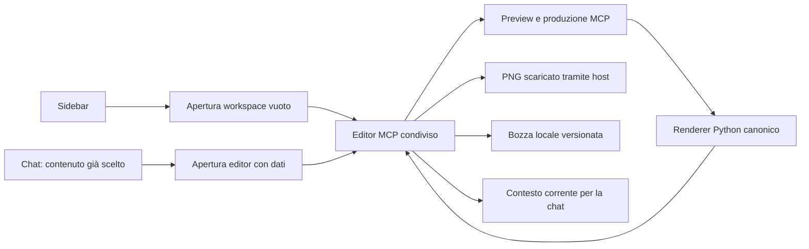

# Quote Card Builder: valutazione e piano MCP Extensions

Data: 13 ottobre 2026. Questo documento conserva la valutazione iniziale. **Il successivo MVP locale 1.8.2 è implementato e verificato:** stato corrente, prove e limiti in [RELEASE-STATUS.md](RELEASE-STATUS.md). Le distribuzioni remote restano da aggiornare.

**Raccomandazione: procedere con un pilot di Extension per desktop, riutilizzando il plugin MCP e il renderer Python esistenti.** Il vantaggio è rendere Quote Card Builder uno strumento che si apre direttamente, conserva il lavoro e resta accanto alla conversazione. Il valore per creator e marketer resta la produzione rapida di una card leggibile e coerente, con controlli limitati e contenuto sotto il loro controllo.

L’Extension è un’integrazione del plugin con le superfici dell’host. Non richiede di riscrivere il renderer, spostarsi su Sites o candidarsi subito alla directory pubblica. Hosting, formato del plugin, interfaccia MCP App ed Extensions sono scelte collegate ma distinte.

## 1. Base esaminata e verifiche

| Elemento | Evidenza del 13 ottobre |
| --- | --- |
| Checkout | Branch `codex/mcp-plugin-v1.7.12`, HEAD `cb232f0`; candidata dichiarata `1.7.16` |
| Modifiche preesistenti | 45 righe in `git status --porcelain`, inclusi file e directory non tracciati; il solo HEAD non rappresenta il codice esaminato |
| GitHub `main` | Verificato via API: `6935680904980e8dc224b0c87c4ab79a4ec2195b`, commit della release 1.5.2; non è una verifica di tutte le release o degli altri branch |
| MCP locale | `mcp[cli]==2.1.1`, `uv.lock`, Python richiesto `>=3.12,<3.15` |
| Suite corrente | 281 test Python superati, nessuno saltato, Python 3.12.13, MCP e MCP Types 2.1.1, ambiente temporaneo con lockfile |
| Proxy Sites | 4 test Node superati |
| Pilot Sites | `get_site` conferma stato `active`, versione più recente 4, accesso `custom`, endpoint MCP e plugin associato |
| UI remota | Il dossier del 2–3 ottobre riporta `v1.45`, contro `v1.40` locale. È un disallineamento storico documentato; la risorsa servita oggi non è stata interrogata |
| MCP Extensions | Repository ufficiale verificato al commit `0d606217705e0e71eb21fff009619b67b80611dc`; changelog e SDK 0.2.0 del 10 ottobre |

Il Site esistente è `appgprj_6abf45cabe3c81918ed306c7f567cd9e`; il plugin associato è `plugin_asdk_app_sites_6a6a4d45dfb48191b73b4bcd47e8a8a7`. La lettura del Site non dimostra installazione, connessione OAuth o apertura nel client. Non sono stati modificati accesso, deployment, plugin installati o file applicativi.

Fonti interne principali: `scripts/mcp_server.py`, `scripts/mcp_app.py`, `scripts/mcp_quote_card.py`, `assets/mcp-editor/`, manifest e builder del plugin, `PRODUCT.md`, `README.md`, `references/mcp-pilot.md`, `submission/`, sorgenti e dossier di `experiments/sites-mcp-pilot/`.

## 2. Quando ha senso

L’investimento è giustificato se l’utente torna spesso a creare card e vuole aprire subito uno strumento familiare, riprendere una bozza e discutere con l’assistente il contenuto che vede. È meno utile per chi produce una card occasionale da una frase già pronta: l’attuale chiamata MCP con editor svolge già gran parte del lavoro.

Il primo incremento deve risolvere tre attriti osservabili:

1. Apertura: partire dalla sidebar senza dover prima rispondere in chat.
2. Continuità: cambiare vista o riaprire lo strumento senza perdere la bozza.
3. Consegna: scaricare il PNG corretto, con esito comprensibile e senza file superati.

La voce nella sidebar da sola offre un beneficio modesto. Continuità della bozza e consegna affidabile sono criteri di accettazione del pilot. Archivio cloud, canvas libero, collaborazione tra utenti e pubblicazione social non sono necessari per validarlo.

## 3. Che cosa è già riutilizzabile

| Base attuale | Riutilizzo | Lavoro necessario |
| --- | --- | --- |
| Renderer Python canonico e validatori | Alto | Conservare lo stesso motore di preview e produzione |
| MCP App autonoma, quattro stili, palette e formattazione | Alto | Apertura vuota, layout fullscreen, stati di caricamento e ripristino |
| Apertura guidata da chat | Alto | Conservare il contratto esistente; separare l’ingresso manuale |
| Tool di preview e produzione privati per la UI | Alto | Restano privati nel primo pilot |
| Tema host e gestione delle risposte superate | Alto | Aggiungere safe area, display mode e verifica delle capacità necessarie |
| Bozza tramite `window.openai.setWidgetState` | Parziale | Non equivale a persistenza garantita su tutti gli host né a un archivio sincronizzato |
| `ui/update-model-context` | Parziale | Separare contesto di sfondo e allegati scelti; gestire rimozione e rimontaggio |
| Produzione SVG e conversione PNG nel browser | Alto | Verifica nel client reale del download e dei fallback |
| Plugin stdio, container Cloud Run, pilot Sites | Alto | Rendere tracciabile la stessa versione nelle distribuzioni |
| Profili e stili salvati nell’editor locale | Parziale | Non sono già disponibili come profili remoti della MCP App |

Il percorso MCP espone oggi 4:5 e 1:1. Il 9:16 e il pacchetto multiformato dell’editor locale sono lavoro separato: non prometterli come effetto automatico dell’Extension.

## 4. Integrazioni consigliate

| Capacità | Priorità | Decisione |
| --- | --- | --- |
| Ingresso globale dalla sidebar | Prima versione | Principale beneficio di accesso; apre una bozza vuota o recuperabile |
| Fullscreen | Prima versione | Preview centrale e controlli leggibili; conservare l’editor inline per il flusso esistente |
| Stato della bozza | Prima versione | Recupero locale verificato, schema versionato, azione esplicita per cancellare |
| Contesto condiviso con la chat | Prima versione, essenziale | Il modello comprende testo, attribuzione, palette e stato della card |
| Ingresso nella singola conversazione | Incremento successivo | Utile dopo aver verificato isolamento delle bozze tra istanze |
| Bozza di messaggio senza invio | Incremento successivo | “Chiedi una revisione” precompila una richiesta modificabile su host compatibili |
| Modifiche applicate dall’assistente | Incremento successivo | Richiede un percorso esplicito per proposte e applicazione alla bozza corrente |
| Impostazioni native | Successivo | Lingua, formato preferito e preferenze; il brand resta una scelta esplicita |
| File di progetto dedicato | Successivo, se richiesto | Valutare `.qcard`, non intercettare genericamente `.json`, `.svg` o `.png` |
| Deep link a una card | Dopo identità e salvataggio | Un URL non crea persistenza né sincronizzazione |
| Menzioni con `@` | Rinviare | Utili soltanto quando esiste un archivio interrogabile |
| Form avanzati e onboarding complesso | Rinviare | L’editor può già raccogliere i pochi dati necessari |

La specifica distingue supporto desktop, Work web e mobile; **esclude Classic ChatGPT dalla matrice pubblicata**. File handler e menzioni sono indicati come funzionalità desktop. Il pilot deve quindi nominare il client effettivamente verificato. Per le API DevDay 2026, i patterns indicano come minimo desktop `26.928.20710`, insieme alla verifica delle capacità: quel numero da solo non certifica ogni API successiva. [Specifica](https://github.com/openai/mcp-extensions/blob/0d606217705e0e71eb21fff009619b67b80611dc/docs/spec.md), [patterns](https://github.com/openai/mcp-extensions/blob/0d606217705e0e71eb21fff009619b67b80611dc/docs/patterns.md).

## 5. Disegno tecnico proposto

### Apertura senza contenuti inventati

Introdurre un tool dedicato, per esempio `quote_card_builder_open_workspace`, che accetti `{}`. Dichiarare nel tool `_meta["openai/ui"].entrypoints: [{"type":"global"}]` e collegarlo a una risorsa UI. La specifica richiede l’input vuoto per global e thread: aggiungere soltanto i metadati al tool attuale non funzionerebbe.

Il nuovo risultato deve descrivere un editor inattivo, non una preview non valida. Usare uno stato di apertura distinto dal modello `EditorState`, che oggi presuppone valori completi. Frase vuota, attribuzione da scegliere e palette da confermare non devono essere trasformate silenziosamente in una card. Attivare preview e generazione quando i dati necessari sono presenti.

Conservare `quote_card_builder_open_editor(text, attribution, profile_mode, ...)` per il percorso da chat. Aggiornare istruzioni e skill affinché i due ingressi non producano richieste duplicate o sovrascrivano una bozza. La distinzione fra “riprendi” e “nuova card” deve essere esplicita.

### Risorsa UI e SDK

Usare una risorsa workspace con preferenza fullscreen e lasciare la risorsa di apertura conversazionale compatibile con l’inline. Entrambe possono incorporare lo stesso bundle: due contesti di apertura non richiedono due editor indipendenti. I metadati di display appartengono al contenuto della risorsa, quelli di ingresso al tool.

L’SDK Python ufficiale `openai-mcp-extensions` 0.2.0 dichiara compatibilità con MCP 2.x, quindi la dipendenza corrente 2.1.1 è nominalmente compatibile. Verificarne la risoluzione e l’integrazione prima di fissare il nuovo lockfile. Per il frontend, usare `App` di `@modelcontextprotocol/ext-apps` con `OpenAIExtensions` di `@openai/mcp-extensions/app`, mantenendo temporaneamente i fallback necessari ai client già serviti. Non usare `createAppTransport`, rimosso nella 0.2.0. Il cambio SDK frontend può seguire il primo test di apertura se aumenta troppo il rischio iniziale. [SDK Python](https://github.com/openai/mcp-extensions/blob/0d606217705e0e71eb21fff009619b67b80611dc/python/README.md), [changelog](https://github.com/openai/mcp-extensions/blob/0d606217705e0e71eb21fff009619b67b80611dc/CHANGELOG.md).

Estrarre gradualmente il JavaScript applicativo dalla stringa HTML di `scripts/mcp_app.py` in `assets/mcp-editor/`; mantenere il bundling autonomo e la CSP restrittiva. Il layout deve usare tema, variabili, safe area e dimensioni host senza modificare la palette dell’output. Provare 375×812, 768×1024 e 1440×900.

### Persistenza e assistente

Per il primo ingresso globale è sufficiente una bozza locale versionata, con ripristino e cancellazione verificati nel client. Non promettere sincronizzazione tra dispositivi. Se si abilita anche l’ingresso thread, non usare una sola chiave globale: provare un’identità di istanza stabile e un isolamento effettivo prima del rilascio.

Il contesto inviato al modello non è il database della bozza. Oggi `host-context.js:175` invia lo stesso stato sia in `structuredContent` sia in un blocco testo visibile. Per il workspace usare un riepilogo strutturato di sfondo; aggiungere contenuti visibili soltanto con selezione esplicita dell’utente, oppure marcare correttamente il testo di compatibilità come destinato all’assistente. Gestire `openai/modelContext`, il suo `updateId`, la rimozione degli allegati e il rimontaggio, senza riaggiungere automaticamente ciò che l’utente ha tolto.

La chat può comprendere la card senza poterla modificare: oggi preview e produzione sono private per l’app. Non presentare il nuovo contesto come editing bidirezionale già risolto. In un secondo incremento scegliere fra proposte che l’utente applica nell’editor e un tool di modifica della bozza. Quest’ultimo richiede identità della bozza, revisione attesa, autorizzazione, conflitti e un canale verificato per notificare l’istanza aperta. Il server HTTP attuale non conserva questo stato.

### Hosting e distribuzione

Per il pilot tecnico usare il plugin locale stdio e il renderer esistente: permette di validare le Extensions senza introdurre un’altra infrastruttura. Per l’accesso cloud riutilizzare il plugin Sites già creato e il servizio Cloud Run, verificando prima il percorso OAuth e l’interfaccia nel client.

Il Worker Sites attuale crea e chiude una sessione Cloud Run per ogni richiesta. È adeguato alle chiamate indipendenti già provate, ma non dimostra supporto a sottoscrizioni, notifiche persistenti o form con più scambi; il bootstrap usa inoltre `capabilities: {}`. Misurare latenza e verificare la negoziazione prima di aggiungere queste funzioni. Non considerarlo un proxy MCP universale.

Conservare identità e audience del pilot. Non migrare il renderer Python su Sites per il solo obiettivo di avere una sidebar: sarebbe un lavoro ulteriore senza beneficio dimostrato. La submission pubblica viene dopo il pilot e richiede una revisione aggiornata del dossier, dell’autenticazione e dell’endpoint scelto.

## 6. Piano di esecuzione e criteri di completamento

Le durate sono stime di lavoro effettivo per un implementatore, con accesso ai client; escludono attese di review e imprevisti delle piattaforme. Non sono un impegno di consegna.

| Fase | Attività e file principali | Completamento | Stima |
| --- | --- | --- | --- |
| 0. Base riproducibile | Ricostruire differenze locali/remoto/deploy; selezionare i file da includere; allineare versioni e CI; rivedere README/PRODUCT | Commit candidato identificabile, suite completa, pacchetto tracciabile, versione servita nota | 0,5–1,5 giorni |
| 1. Apertura Extension | `mcp_server.py`, `mcp_app.py`, dipendenze e lockfile, test protocollo | Il tool accetta `{}`, non genera contenuti, la sidebar apre davvero l’editor nel client | 1–2 giorni |
| 2. Workspace utilizzabile | `assets/mcp-editor/`, apertura vuota, layout, recupero bozza, contesto essenziale | Riapertura senza perdita, tema corretto, stati comprensibili, PNG corretto, flusso chat precedente funzionante | 2–4 giorni |
| 3. Pilot cloud e pacchetto | Builder, container, pilot Sites, istruzioni e dossier prove | Stessa versione identificabile, OAuth e flusso completo verificati sul client scelto | 1–2 giorni |
| 4. Incrementi selettivi | Revisione assistita, profili, ingresso thread, eventuale file `.qcard` | Solo dopo evidenza d’uso; ogni incremento con stato e autorizzazioni definiti | Da stimare separatamente |

Ordine di grandezza: **circa 5–10 giornate per un pilot affidabile**, meno per una sola dimostrazione di apertura. Il lavoro incerto riguarda soprattutto continuità nel client e distribuzione, non il rendering.

La CI corrente contiene Python 3.10/3.11 mentre `pyproject.toml` richiede almeno 3.12; inoltre gli script importano `tomllib`. Allineare esplicitamente la matrice al runtime supportato. README presenta ancora il plugin come skills-only e PRODUCT descrive soprattutto l’editor locale: aggiornare la promessa di prodotto quando si implementa, senza confondere le capacità delle due distribuzioni.

## 7. Prove richieste prima di considerarlo riuscito

1. Apertura reale da sidebar con `{}`; nessuna citazione o attribuzione inventata e nessuna card generata prima dell’azione utente.
2. Percorso da chat completo: una sola apertura, dati preservati, quattro stili e due formati MCP.
3. Modifica, navigazione, rimontaggio e riavvio: bozza recuperata; nuova card e cancellazione non recuperano per errore quella precedente.
4. Preview lenta e modifica durante la produzione: nessun PNG superato consegnato come corrente.
5. Download dal client reale: dimensioni e contenuto corretti; una risposta di accettazione dell’host da sola non prova che il file sia stato salvato.
6. Contesto: il modello comprende la card corrente, non riceve SVG/base64 inutili; rimozione degli allegati rispettata. Nessuna promessa di modifica automatica prima del relativo incremento.
7. Layout largo/stretto, tema chiaro/scuro, tastiera, focus e safe area; palette della card invariata al cambio tema.
8. Host privo delle nuove capacità: percorso MCP esistente ancora utilizzabile o limite esplicito, nessuna falsa conferma.
9. Se abilitato l’ingresso thread: due conversazioni e due istanze senza contaminazione delle bozze.
10. Nel pilot cloud: installazione/connessione OAuth, tool, UI e PNG attraverso il plugin, non soltanto chiamate dirette al backend.

Per valutare il beneficio, confrontare tre attività reali con il flusso attuale: card da frase pronta, card selezionata da un testo e ripresa di una bozza. Registrare tempo al primo PNG, numero di domande preliminari, errori e perdita di stato. Proseguire se l’accesso diretto e il recupero migliorano l’uso senza aumentare i passaggi; ridurre l’ambizione se l’unico risultato è una nuova icona.

## 8. Limiti della presente revisione

Sono stati letti codice, documentazione locale e fonti ufficiali correnti; verificate la testa di `main` e la configurazione del Site; eseguiti i test esistenti. Non sono state implementate Extensions, provati nuovi SDK nel progetto, aperte UI di test nel client, verificate tutte le piattaforme, eseguite submission o controllate tutte le release remote. I 281 test superati non certificano funzioni ancora da sviluppare. Le evidenze storiche del pilot sono indicate come tali.

Fonti ufficiali aggiuntive: [SDK TypeScript e integrazione dell’app](https://github.com/openai/mcp-extensions/blob/0d606217705e0e71eb21fff009619b67b80611dc/typescript/README.md), [dipendenze SDK Python](https://github.com/openai/mcp-extensions/blob/0d606217705e0e71eb21fff009619b67b80611dc/python/pyproject.toml), [commit di riferimento](https://github.com/openai/mcp-extensions/commit/0d606217705e0e71eb21fff009619b67b80611dc).
